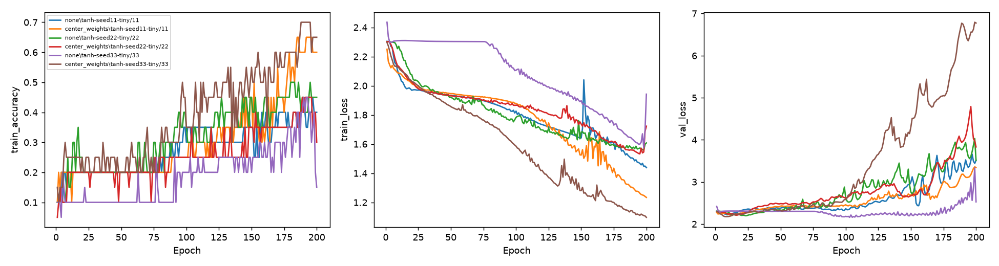

# 生成權重中心化對照

Study: `centering-7f231401b6`

| transform      |   seed |   maximum_train_accuracy |   final_train_accuracy |   final_train_loss |   best_epoch |   best_train_accuracy |   best_val_accuracy |   best_val_loss |
|:---------------|-------:|-------------------------:|-----------------------:|-------------------:|-------------:|----------------------:|--------------------:|----------------:|
| none           |     11 |                     0.45 |                   0.4  |            1.43858 |            9 |                  0.2  |            0.139276 |         2.21797 |
| center_weights |     11 |                     0.65 |                   0.6  |            1.23405 |           12 |                  0.1  |            0.144847 |         2.22214 |
| none           |     22 |                     0.5  |                   0.45 |            1.60751 |           23 |                  0.2  |            0.167131 |         2.19714 |
| center_weights |     22 |                     0.45 |                   0.3  |            1.72239 |           16 |                  0.2  |            0.158774 |         2.21118 |
| none           |     33 |                     0.45 |                   0.15 |            1.94202 |          103 |                  0.25 |            0.16156  |         2.15859 |
| center_weights |     33 |                     0.7  |                   0.65 |            1.09744 |            8 |                  0.25 |            0.172702 |         2.17518 |

固定20筆train；各線一個處理/seed。沒有test；best checkpoint依validation loss。中心化僅W1/W2各自減平均，不改bias、不除以std、不做fan-in scaling。同seed具有相同原始初始化。最高train accuracy僅為擬合診斷。

設定、初始化層級統計和逐epoch診斷見manifest.json。
