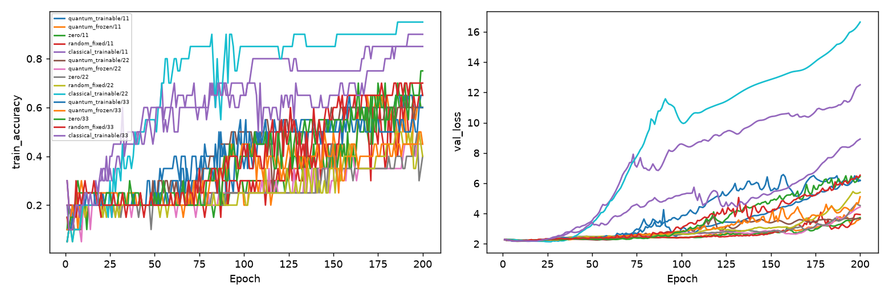

# 量子與傳統特徵重訓對照

Study: `classical-features-66658d6e1b`

| condition           |   n |   max_train_mean |   final_train_mean |   final_train_std |   val_mean |    val_std |   val_loss_mean |
|:--------------------|----:|-----------------:|-------------------:|------------------:|-----------:|-----------:|----------------:|
| classical_trainable |   3 |         0.9      |           0.9      |         0.05      |   0.172702 | 0.0313912  |         2.16407 |
| quantum_frozen      |   3 |         0.533333 |           0.5      |         0.0866025 |   0.162488 | 0.0112575  |         2.2033  |
| quantum_trainable   |   3 |         0.65     |           0.616667 |         0.0288675 |   0.15506  | 0.0140201  |         2.2015  |
| random_fixed        |   3 |         0.633333 |           0.583333 |         0.160728  |   0.15506  | 0.00321644 |         2.20764 |
| zero                |   3 |         0.633333 |           0.583333 |         0.175594  |   0.158774 | 0.0139276  |         2.20282 |

| condition           |   seed |   max_train_accuracy |   final_train_accuracy |   final_train_loss |   best_epoch |   initial_feature_std |   feature_trainable_parameters |   val_accuracy |   val_loss |
|:--------------------|-------:|---------------------:|-----------------------:|-------------------:|-------------:|----------------------:|-------------------------------:|---------------:|-----------:|
| quantum_trainable   |     11 |                 0.65 |                   0.65 |           0.881799 |           13 |              0.123529 |                             30 |       0.153203 |    2.21268 |
| quantum_frozen      |     11 |                 0.65 |                   0.6  |           1.2197   |           13 |              0.123529 |                              0 |       0.155989 |    2.22111 |
| zero                |     11 |                 0.65 |                   0.6  |           1.18026  |           12 |              0        |                              0 |       0.144847 |    2.22214 |
| random_fixed        |     11 |                 0.7  |                   0.65 |           1.06635  |           12 |              0.123529 |                              0 |       0.153203 |    2.22054 |
| classical_trainable |     11 |                 0.9  |                   0.9  |           0.366662 |           14 |              0.123529 |                             30 |       0.155989 |    2.17293 |
| quantum_trainable   |     22 |                 0.65 |                   0.6  |           1.00213  |           15 |              0.123249 |                             30 |       0.142061 |    2.21027 |
| quantum_frozen      |     22 |                 0.45 |                   0.45 |           1.53239  |           16 |              0.123249 |                              0 |       0.155989 |    2.21344 |
| zero                |     22 |                 0.5  |                   0.4  |           1.52933  |           16 |              0        |                              0 |       0.158774 |    2.21119 |
| random_fixed        |     22 |                 0.5  |                   0.4  |           1.50559  |           16 |              0.123249 |                              0 |       0.158774 |    2.21473 |
| classical_trainable |     22 |                 0.95 |                   0.95 |           0.148929 |           26 |              0.123249 |                             30 |       0.208914 |    2.14276 |
| quantum_trainable   |     33 |                 0.65 |                   0.6  |           1.12173  |            6 |              0.102979 |                             30 |       0.169916 |    2.18155 |
| quantum_frozen      |     33 |                 0.5  |                   0.45 |           1.31547  |            8 |              0.102979 |                              0 |       0.175487 |    2.17534 |
| zero                |     33 |                 0.75 |                   0.75 |           1.05572  |            8 |              0        |                              0 |       0.172702 |    2.17512 |
| random_fixed        |     33 |                 0.7  |                   0.7  |           0.983275 |            7 |              0.102979 |                              0 |       0.153203 |    2.18763 |
| classical_trainable |     33 |                 0.85 |                   0.85 |           0.616613 |            6 |              0.102979 |                             30 |       0.153203 |    2.17651 |

每線一個condition/seed，20筆train，未使用test。可訓練量子/傳統各30參數；相同mapping初始權重與初始非零feature標準差，但不同feature表示、梯度幾何和計算成本，不是完整等價比較。Random fixed與classical trainable起始feature逐元素相同，後者學習30維固定隨機基底係數；不是610維自由embedding。Gain只初始化校準一次。Best依validation loss選取；低表現小樣本不能支持一般量子優勢/無效結論。配置、環境、歷史见manifest.json。
