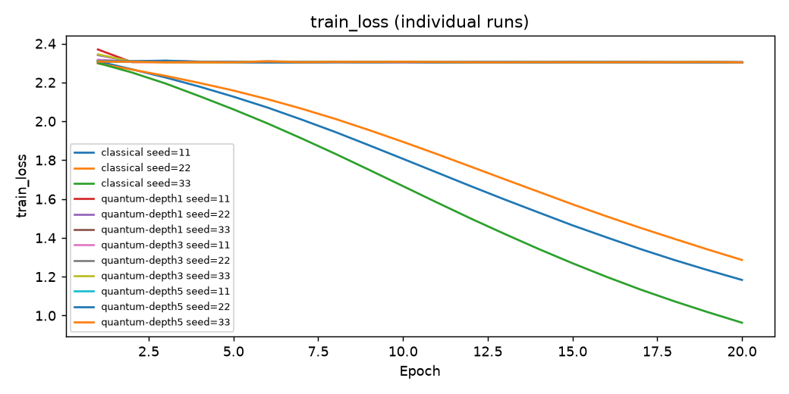
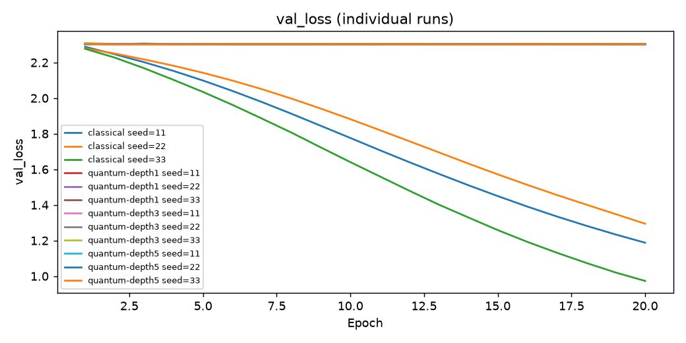
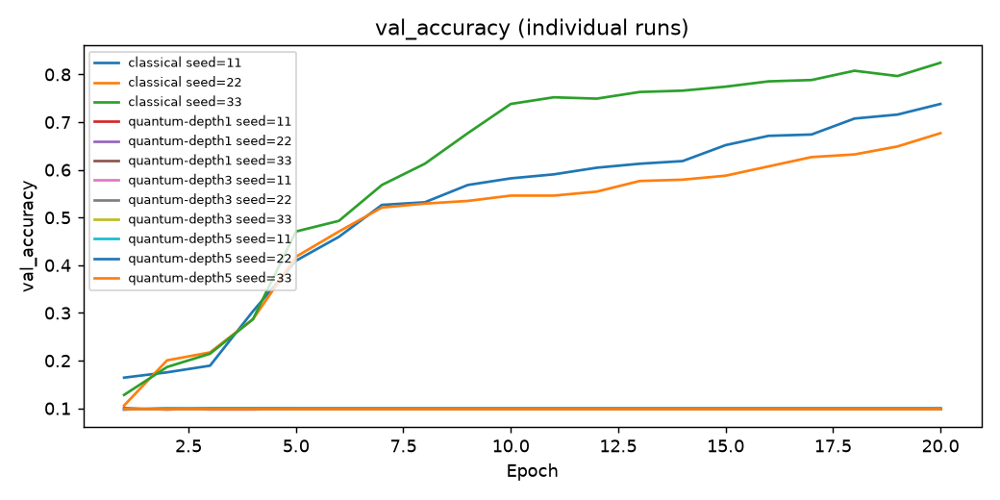
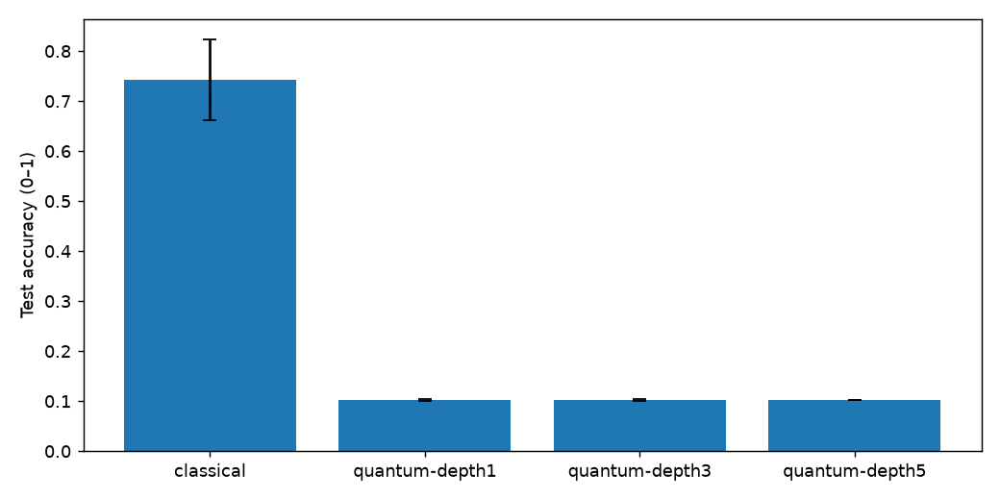
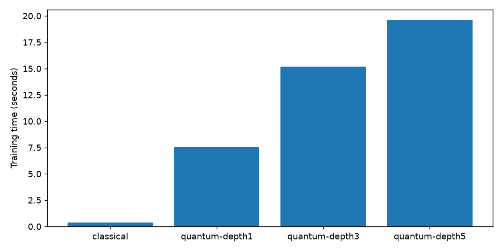

# QuantumTrain 電路深度適配實驗

研究問題：同 epoch 預算下，1/3/5 層電路如何影響精度與成本？

來源：[QuantumTrain](https://github.com/Hon-Hai-Quantum-Computing/QuantumTrain)，參照 commit d5b654116565ae9550e540e021ab0d4160a15c86。

| group          | mode   |   expected |   completed |   failed | missing_seeds   | status   |   accuracy_mean |   accuracy_std |   train_seconds_mean |   parameters |
|:---------------|:-------|-----------:|------------:|---------:|:----------------|:---------|----------------:|---------------:|---------------------:|-------------:|
| classical      | full   |          3 |           3 |        0 | []              | complete |        0.742593 |       0.080954 |             0.385123 |          610 |
| quantum-depth1 | full   |          3 |           3 |        0 | []              | complete |        0.101852 |       0.001604 |             7.57003  |        16771 |
| quantum-depth3 | full   |          3 |           3 |        0 | []              | complete |        0.101852 |       0.001604 |            15.1735   |        16791 |
| quantum-depth5 | full   |          3 |           3 |        0 | []              | complete |        0.102778 |       0        |            19.6362   |        16811 |

## Run 狀態
- 20261006T211531-8a35e0a6b0: completed 
- 20261006T211534-6c7f2ac83e: completed 
- 20261006T211535-9b8448d35f: completed 
- 20261006T211536-b44028d012: completed 
- 20261006T211547-4187d6e866: completed 
- 20261006T211557-73d1d0178f: completed 
- 20261006T211607-63d282ac05: completed 
- 20261006T211626-95cb58540d: completed 
- 20261006T211643-f32b9cbeea: completed 
- 20261006T211703-aa64f0b033: completed 
- 20261006T211726-9145d3b386: completed 
- 20261006T211747-b1f926a7b5: completed 

## 圖表

橫軸 epoch；縱軸 train_loss，每線一個 run；loss 為樣本平均交叉熵，accuracy 為 0–1。曲線不代表量子優勢。

橫軸 epoch；縱軸 val_loss，每線一個 run；loss 為樣本平均交叉熵，accuracy 為 0–1。曲線不代表量子優勢。

橫軸 epoch；縱軸 val_accuracy，每線一個 run；loss 為樣本平均交叉熵，accuracy 為 0–1。曲線不代表量子優勢。

組別比較：Test accuracy (0–1)；accuracy 誤差棒為樣本標準差，單次不畫誤差棒。不完整組只描述已完成的 runs。

組別比較：Training time (seconds)；accuracy 誤差棒為樣本標準差，單次不畫誤差棒。不完整組只描述已完成的 runs。

## 協定與限制
完整設定、逐次結果與 run IDs 見 manifest.json；原始 metrics/checkpoint 見本機 results。以 validation loss 選 checkpoint，test 只作 final evaluation。三 seeds 是描述統計；同 epochs 不等於同成本；深度同時改變參數量。10-qubit 理想模擬 backprop 不代表 QPU 成本。Mapping 比目標 MLP 大，不能宣稱壓縮。失敗與缺 seed 不可當作成功排除。
