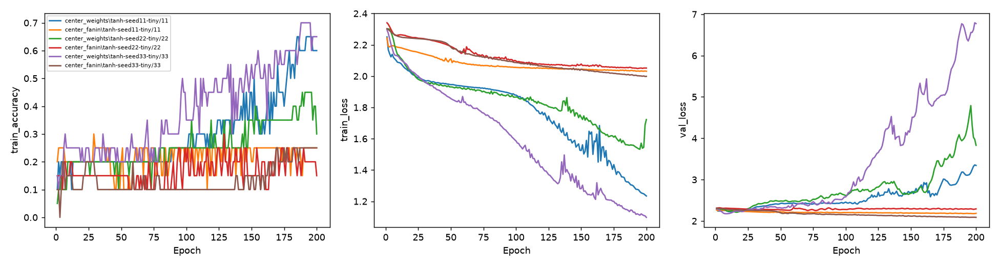

# 中心化後的fan-in尺度對照

Study: `fanin-104276cae2`

| transform      |   seed |   maximum_train_accuracy |   final_train_accuracy |   final_train_loss |   best_epoch |   best_train_accuracy |   best_val_accuracy |   best_val_loss |
|:---------------|-------:|-------------------------:|-----------------------:|-------------------:|-------------:|----------------------:|--------------------:|----------------:|
| center_weights |     11 |                     0.65 |                   0.6  |            1.23405 |           12 |                  0.1  |            0.144847 |         2.22214 |
| center_fanin   |     11 |                     0.3  |                   0.25 |            2.03129 |          198 |                  0.25 |            0.144847 |         2.17686 |
| center_weights |     22 |                     0.45 |                   0.3  |            1.72239 |           16 |                  0.2  |            0.158774 |         2.21118 |
| center_fanin   |     22 |                     0.3  |                   0.15 |            2.05141 |           77 |                  0.2  |            0.155989 |         2.25205 |
| center_weights |     33 |                     0.7  |                   0.65 |            1.09744 |            8 |                  0.25 |            0.172702 |         2.17518 |
| center_fanin   |     33 |                     0.25 |                   0.25 |            1.99839 |          195 |                  0.25 |            0.178273 |         2.0874  |

固定20筆train；各線一個處理/seed。沒有test；best checkpoint依validation loss。控制組僅中心化W1/W2；處理組每次forward再除以floored std，乘以1/sqrt(3*fan_in)，bias保持不變。這是持續的可微分重參數化，不只是初始化；不是He initialization，也不產生獨立均勻權重。同seed具有相同原始初始化。最高train accuracy僅為擬合診斷。

設定、初始化層級統計和逐epoch診斷見manifest.json。
