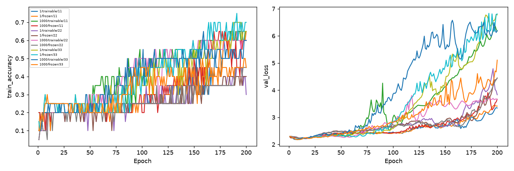

# 量子特徵尺度 × 可訓練性

Study: `feature-scale-e11a85e95b`

|                       |   n |   max_train_mean |   final_train_mean |   final_train_std |   val_mean |   val_std |   val_loss_mean |
|:----------------------|----:|-----------------:|-------------------:|------------------:|-----------:|----------:|----------------:|
| (1.0, 'frozen')       |   3 |         0.616667 |           0.583333 |         0.160728  |   0.158774 | 0.0139276 |         2.20283 |
| (1.0, 'trainable')    |   3 |         0.6      |           0.516667 |         0.189297  |   0.158774 | 0.0139276 |         2.20284 |
| (1000.0, 'frozen')    |   3 |         0.533333 |           0.5      |         0.0866025 |   0.162488 | 0.0112575 |         2.2033  |
| (1000.0, 'trainable') |   3 |         0.65     |           0.616667 |         0.0288675 |   0.15506  | 0.0140201 |         2.2015  |

|   scale | condition   |   seed |   max_train_accuracy |   final_train_accuracy |   best_val_accuracy |   best_val_loss |   best_epoch |   peak_saturation |   best_scaled_feature_std |   zero_feature_weight_delta |
|--------:|:------------|-------:|---------------------:|-----------------------:|--------------------:|----------------:|-------------:|------------------:|--------------------------:|----------------------------:|
|       1 | trainable   |     11 |                 0.65 |                   0.6  |            0.144847 |         2.22214 |           12 |        0.00168033 |               0.00127404  |                 9.86814e-05 |
|       1 | frozen      |     11 |                 0.65 |                   0.65 |            0.144847 |         2.22214 |           12 |        0.00114754 |               0.000123529 |                 1.01502e-05 |
|    1000 | trainable   |     11 |                 0.65 |                   0.65 |            0.153203 |         2.21268 |           13 |        0.0162705  |               1.36823     |                 0.182112    |
|    1000 | frozen      |     11 |                 0.65 |                   0.6  |            0.155989 |         2.22111 |           13 |        0.00454918 |               0.123529    |                 0.0134354   |
|       1 | trainable   |     22 |                 0.45 |                   0.3  |            0.158774 |         2.21118 |           16 |        0          |               0.000703276 |                 4.30803e-05 |
|       1 | frozen      |     22 |                 0.45 |                   0.4  |            0.158774 |         2.21119 |           16 |        0          |               0.000123249 |                 8.40119e-06 |
|    1000 | trainable   |     22 |                 0.65 |                   0.6  |            0.142061 |         2.21027 |           15 |        0.00598361 |               1.22112     |                 0.0946549   |
|    1000 | frozen      |     22 |                 0.45 |                   0.45 |            0.155989 |         2.21344 |           16 |        0          |               0.123249    |                 0.00671415  |
|       1 | trainable   |     33 |                 0.7  |                   0.65 |            0.172702 |         2.17518 |            8 |        0.00463115 |               0.000910548 |                 0.000190995 |
|       1 | frozen      |     33 |                 0.75 |                   0.7  |            0.172702 |         2.17517 |            8 |        0.00270492 |               0.000102979 |                 2.05123e-05 |
|    1000 | trainable   |     33 |                 0.65 |                   0.6  |            0.169916 |         2.18155 |            6 |        0.00295082 |               0.697559    |                 0.194485    |
|    1000 | frozen      |     33 |                 0.5  |                   0.45 |            0.175487 |         2.17534 |            8 |        0          |               0.102979    |                 0.0203656   |

每線一個scale/condition/seed；20筆固定train。倍率作用於機率後處理與中心化之後、mapping之前，並改變量子梯度尺度。Frozen仍使用初始量子特徵。飽和比例為每層Tanh輸出abs>.99，peak_saturation取訓練各epoch/層最大值。Best由validation loss選取；未使用test。三seed僅描述統計，feature置零未重訓不是獨立baseline。配置、環境、診斷、敏感度見manifest.json。
