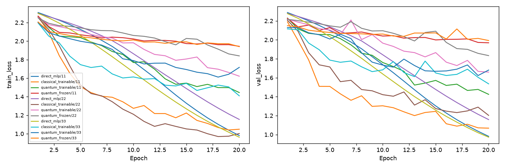

# 第二階段：完整train/validation比較

Study: `full-validation-9c8e7d4048`

| condition           |   n |   best_train_mean |   val_mean |   val_std |   val_loss_mean |   final_train_mean |   final_val_mean |   train_seconds_mean |
|:--------------------|----:|------------------:|-----------:|----------:|----------------:|-------------------:|-----------------:|---------------------:|
| classical_trainable |   3 |          0.611626 |   0.585887 | 0.104571  |         1.26859 |           0.611626 |         0.585887 |              4.04045 |
| direct_mlp          |   3 |          0.810761 |   0.802228 | 0.0642483 |         1.03734 |           0.810761 |         0.802228 |              0.6103  |
| quantum_frozen      |   3 |          0.236858 |   0.239554 | 0.0421525 |         1.9316  |           0.236858 |         0.239554 |             15.6401  |
| quantum_trainable   |   3 |          0.401979 |   0.410399 | 0.0517636 |         1.56893 |           0.386518 |         0.392758 |             25.7933  |

| condition           |   seed |   best_epoch |   best_train_accuracy |   best_val_accuracy |   best_val_loss |   final_train_accuracy |   final_val_accuracy |   train_seconds |   trainable_parameters |   buffer_elements |
|:--------------------|-------:|-------------:|----------------------:|--------------------:|----------------:|-----------------------:|---------------------:|----------------:|-----------------------:|------------------:|
| direct_mlp          |     11 |           20 |              0.858071 |            0.852368 |        0.981468 |               0.858071 |             0.852368 |        0.553897 |                    610 |                 0 |
| classical_trainable |     11 |           20 |              0.652134 |            0.649025 |        1.06778  |               0.652134 |             0.649025 |        3.44796  |                  16791 |             24401 |
| quantum_trainable   |     11 |           20 |              0.45269  |            0.467967 |        1.42461  |               0.45269  |             0.467967 |       25.8468   |                  16791 |              6100 |
| quantum_frozen      |     11 |           20 |              0.217996 |            0.225627 |        1.96873  |               0.217996 |             0.225627 |       15.4447   |                  16761 |              6100 |
| direct_mlp          |     22 |           20 |              0.734694 |            0.729805 |        1.15818  |               0.734694 |             0.729805 |        0.623344 |                    610 |                 0 |
| classical_trainable |     22 |           20 |              0.699443 |            0.643454 |        1.20257  |               0.699443 |             0.643454 |        4.40436  |                  16791 |             24401 |
| quantum_trainable   |     22 |           20 |              0.369202 |            0.367688 |        1.65897  |               0.369202 |             0.367688 |       26.0417   |                  16791 |              6100 |
| quantum_frozen      |     22 |           20 |              0.295918 |            0.286908 |        1.83347  |               0.295918 |             0.286908 |       15.8179   |                  16761 |              6100 |
| direct_mlp          |     33 |           20 |              0.839518 |            0.824513 |        0.972379 |               0.839518 |             0.824513 |        0.653659 |                    610 |                 0 |
| classical_trainable |     33 |           20 |              0.483302 |            0.465181 |        1.53541  |               0.483302 |             0.465181 |        4.26905  |                  16791 |             24401 |
| quantum_trainable   |     33 |           19 |              0.384045 |            0.395543 |        1.62321  |               0.337662 |             0.342618 |       25.4915   |                  16791 |              6100 |
| quantum_frozen      |     33 |           20 |              0.19666  |            0.206128 |        1.99259  |               0.19666  |             0.206128 |       15.6577   |                  16761 |              6100 |

每線一個condition/seed。Train loss是訓練過程中的樣本加權平均，validation loss是epoch結束後評估。Best train/validation均在同一最低validation loss checkpoint重測；final指最後epoch。沒有test評估；已用於選架構與checkpoint的validation不是獨立泛化證據。同epochs不等於同運算預算。直接MLP的參數化/初始化與生成器不同；傳統生成器有額外固定隨機基底儲存。Frozen量子仍在模擬器計算機率，時間未做快取最佳化。CPU計時僅描述當機器，不代表QPU或硬體優勢。詳見manifest協定及環境。
