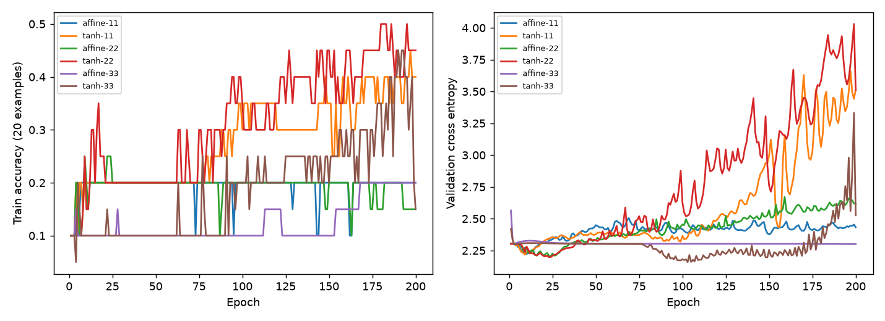

# 固定 LeakyReLU 的 Mapping 對照

Study: `leaky-mapping-b5be7b4cfc`

Train/validation-only 探索性實驗，未使用test。

| mapping   |   seed |   best_epoch |   maximum_train_accuracy |   final_train_accuracy |   best_train_accuracy |   best_val_accuracy |   nonadditive_relative |
|:----------|-------:|-------------:|-------------------------:|-----------------------:|----------------------:|--------------------:|-----------------------:|
| affine    |     11 |           10 |                     0.2  |                   0.2  |                  0.2  |            0.153203 |            5.53368e-07 |
| tanh      |     11 |            9 |                     0.45 |                   0.4  |                  0.2  |            0.139276 |            0.0667863   |
| affine    |     22 |           23 |                     0.25 |                   0.15 |                  0.25 |            0.189415 |            9.54851e-07 |
| tanh      |     22 |           23 |                     0.5  |                   0.45 |                  0.2  |            0.167131 |            0.0729835   |
| affine    |     33 |            3 |                     0.2  |                   0.2  |                  0.1  |            0.111421 |            4.77842e-07 |
| tanh      |     33 |          103 |                     0.45 |                   0.15 |                  0.25 |            0.16156  |            0.0514209   |



左：固定20筆train的擬合；右：validation loss。每條線一個seed。最高train accuracy是能力診斷；best checkpoint只由validation loss選取。權重nonadditive_relative是best checkpoint第一層8×64矩陣扣除row/column加性近似後的相對Frobenius norm，不是任務效能或量子優勢指標。

## 凍結設定
```json
{
  "target_activation": "leaky_relu",
  "negative_slope": 0.01,
  "depth": 3,
  "q_delta": 0.001,
  "mappings": [
    "affine",
    "tanh"
  ],
  "seeds": [
    11,
    22,
    33
  ],
  "epochs": 200,
  "train_samples": 20,
  "split_seed": 2026,
  "optimizer": "Adam",
  "learning_rate": 0.001,
  "smoke": false,
  "test_access": false
}
```

完整配置、環境、每epoch診斷和奇異值保存在manifest.json。三seeds只供描述；非線性改善不證明量子分支的增量價值。
