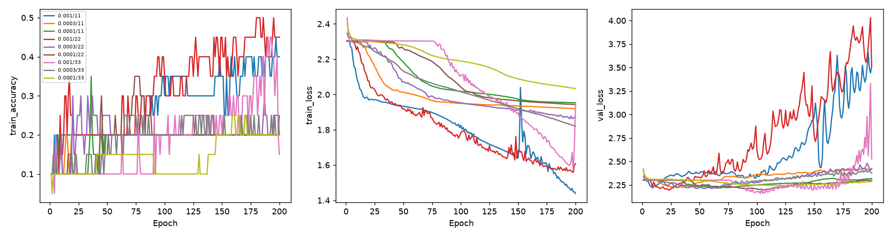

# Learning rate 單變因研究

Study: `learning-rate-f37260840c`

只使用train/validation，不讀test。

|   learning_rate |   n |   max_train_mean |   final_train_mean |   final_train_std |   drop_mean |   tail_loss_std_mean |   val_mean |   val_std |
|----------------:|----:|-----------------:|-------------------:|------------------:|------------:|---------------------:|-----------:|----------:|
|          0.0001 |   3 |         0.316667 |           0.2      |         0         |   0.116667  |           0.00284259 |   0.144847 | 0.0290816 |
|          0.0003 |   3 |         0.25     |           0.216667 |         0.0288675 |   0.0333333 |           0.00701404 |   0.153203 | 0.014474  |
|          0.001  |   3 |         0.466667 |           0.333333 |         0.160728  |   0.133333  |           0.0401814  |   0.155989 | 0.0147396 |

## 逐run
|   learning_rate |   seed |   maximum_train_accuracy |   final_train_accuracy |   peak_to_final_drop |   tail_accuracy_std |   tail_loss_std |   final_train_loss |   best_epoch |   best_val_accuracy |   best_val_loss |
|----------------:|-------:|-------------------------:|-----------------------:|---------------------:|--------------------:|----------------:|-------------------:|-------------:|--------------------:|----------------:|
|          0.001  |     11 |                     0.45 |                   0.4  |                 0.05 |         0.0254951   |      0.0350796  |            1.43858 |            9 |            0.139276 |         2.21797 |
|          0.0003 |     11 |                     0.2  |                   0.2  |                 0    |         2.77556e-17 |      0.00172443 |            1.91978 |           31 |            0.16156  |         2.22208 |
|          0.0001 |     11 |                     0.35 |                   0.2  |                 0.15 |         2.77556e-17 |      0.00110149 |            1.95288 |           67 |            0.158774 |         2.21845 |
|          0.001  |     22 |                     0.5  |                   0.45 |                 0.05 |         0.0334477   |      0.0117288  |            1.60751 |           23 |            0.167131 |         2.19714 |
|          0.0003 |     22 |                     0.3  |                   0.2  |                 0.1  |         0.0295804   |      0.00681752 |            1.86852 |           54 |            0.16156  |         2.213   |
|          0.0001 |     22 |                     0.35 |                   0.2  |                 0.15 |         2.77556e-17 |      0.00199051 |            1.94291 |          106 |            0.164345 |         2.1979  |
|          0.001  |     33 |                     0.45 |                   0.15 |                 0.3  |         0.083666    |      0.0737356  |            1.94202 |          103 |            0.16156  |         2.15859 |
|          0.0003 |     33 |                     0.25 |                   0.25 |                 0    |         0.02        |      0.0125002  |            1.82151 |           66 |            0.13649  |         2.21566 |
|          0.0001 |     33 |                     0.25 |                   0.2  |                 0.05 |         2.77556e-17 |      0.00543577 |            2.03368 |          126 |            0.111421 |         2.24162 |



每線一個lr/seed；固定20筆，200epochs（smoke只有2epochs）。drop為最高train accuracy減最後accuracy；tail loss std為最後最多20epochs loss的母體標準差，描述時間波動，不是独立抽樣不確定度。val指validation loss最佳checkpoint的accuracy。較低波動不代表學得更好，需同時看loss、accuracy與收斂進度。同epochs不等於各LR都收斂。

## 協定
```json
{
  "smoke": false,
  "rates": [
    0.001,
    0.0003,
    0.0001
  ],
  "seeds": [
    11,
    22,
    33
  ],
  "epochs": 200,
  "mapping": "tanh",
  "target": "leaky_relu",
  "negative_slope": 0.01,
  "depth": 3,
  "q_delta": 0.001,
  "train_samples": 20,
  "split_seed": 2026,
  "test_access": false,
  "tail_epochs": 20,
  "status": "completed"
}
```
