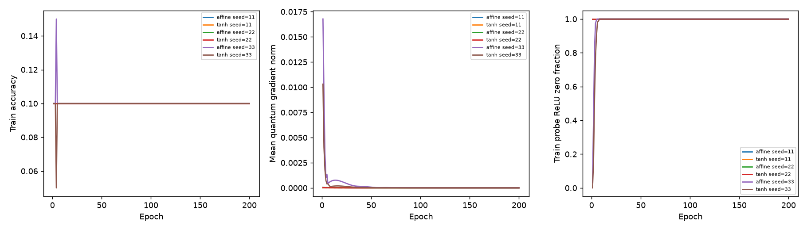
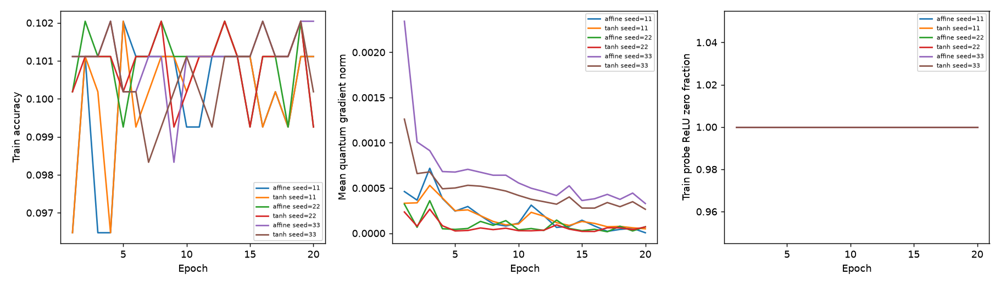

# Mapping 診斷與延伸報告

來源 study：`mapping-710a60bdbc`；完成 12/12 runs。Mode：validation-only exploratory study。

| tiny   | activation   |   n |   val_mean |    val_std |   train_max_mean |   seconds_mean |
|:-------|:-------------|----:|-----------:|-----------:|-----------------:|---------------:|
| False  | affine       |   3 |   0.100279 | 0          |         0.102041 |       10.8125  |
| False  | tanh         |   3 |   0.100279 | 0          |         0.102041 |       12.9825  |
| True   | affine       |   3 |   0.103993 | 0.00643287 |         0.116667 |        7.48911 |
| True   | tanh         |   3 |   0.09935  | 0.00160822 |         0.1      |        7.72461 |

train_max_mean 是各run整段訓練最高accuracy的平均，僅供過擬合診斷；val_mean由validation loss最佳checkpoint計算，不是最高validation accuracy。秒數只含訓練batch。

20筆訓練集：各線為一個seed；左右依序為訓練accuracy、量子梯度norm、固定train probe的ReLU零比例。

完整train情境（smoke則為40筆）：相同軸定義。

## 限制
固定depth3、q_delta=.001、Adam lr=.001；兩組初始參數相同，Tanh不增加參數。此輪沒有使用test。非線性mapping的效果不能證明量子學習的增量價值；仍需固定量子參數消融。三seeds僅供描述，validation也不能當反覆調參後的獨立最終評估。詳細config、逐epoch分布、梯度、更新量與環境見manifest.json。
