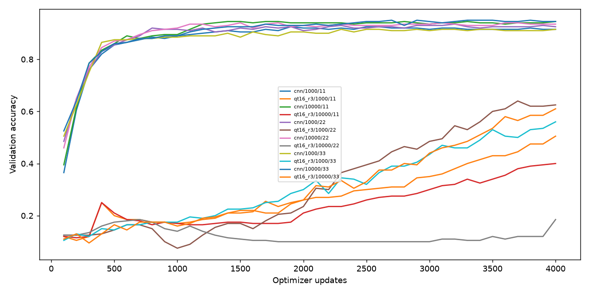

# MNIST同更新預算資料覆蓋研究

Study: `paper-data-budget-9fc8b65ab4`

|                    |   n |   train_mean |   val_mean |    val_std |   val_loss_mean |
|:-------------------|----:|-------------:|-----------:|-----------:|----------------:|
| ('cnn', 1000)      |   3 |     0.978    |   0.91     | 0.0132288  |        0.309245 |
| ('cnn', 10000)     |   3 |     0.9633   |   0.943333 | 0.00763763 |        0.148783 |
| ('qt16_r3', 1000)  |   3 |     0.587    |   0.563333 | 0.0600694  |        1.38581  |
| ('qt16_r3', 10000) |   3 |     0.394667 |   0.398333 | 0.212505   |        1.76872  |

| condition   |   train_size |   seed |   parameters |   updates |   examples_seen |   unique_examples_seen |   best_update |   train_accuracy |   val_accuracy |   val_loss |   final_val_accuracy | export_delta   |
|:------------|-------------:|-------:|-------------:|----------:|----------------:|-----------------------:|--------------:|-----------------:|---------------:|-----------:|---------------------:|:---------------|
| cnn         |         1000 |     11 |         6690 |      4000 |          512000 |                   1000 |          2200 |           0.991  |          0.915 |   0.310337 |                0.915 | N/A            |
| qt16_r3     |         1000 |     11 |          457 |      4000 |          512000 |                   1000 |          4000 |           0.516  |          0.505 |   1.59634  |                0.505 | 0.0            |
| cnn         |        10000 |     11 |         6690 |      4000 |          512000 |                  10000 |          4000 |           0.9676 |          0.945 |   0.129658 |                0.945 | N/A            |
| qt16_r3     |        10000 |     11 |          457 |      4000 |          512000 |                  10000 |          4000 |           0.4162 |          0.4   |   1.72239  |                0.4   | 0.0            |
| cnn         |         1000 |     22 |         6690 |      4000 |          512000 |                   1000 |          1800 |           0.973  |          0.92  |   0.291335 |                0.925 | N/A            |
| qt16_r3     |         1000 |     22 |          457 |      4000 |          512000 |                   1000 |          4000 |           0.638  |          0.625 |   1.2459   |                0.625 | 0.0            |
| cnn         |        10000 |     22 |         6690 |      4000 |          512000 |                  10000 |          4000 |           0.9636 |          0.935 |   0.174897 |                0.935 | N/A            |
| qt16_r3     |        10000 |     22 |          457 |      4000 |          512000 |                  10000 |          4000 |           0.173  |          0.185 |   2.29507  |                0.185 | 0.0            |
| cnn         |         1000 |     33 |         6690 |      4000 |          512000 |                   1000 |          1700 |           0.97   |          0.895 |   0.326062 |                0.915 | N/A            |
| qt16_r3     |         1000 |     33 |          457 |      4000 |          512000 |                   1000 |          4000 |           0.607  |          0.56  |   1.3152   |                0.56  | 0.0            |
| cnn         |        10000 |     33 |         6690 |      4000 |          512000 |                  10000 |          3800 |           0.9587 |          0.95  |   0.141794 |                0.945 | N/A            |
| qt16_r3     |        10000 |     33 |          457 |      4000 |          512000 |                  10000 |          4000 |           0.5948 |          0.61  |   1.2887   |                0.61  | 0.0            |

每線一個模型/資料量/seed；橫軸updates。兩組同updates、每batch128、相同validation及評估次數。使用有放回抽樣，不能直接與舊epoch shuffle研究混比。集合交集與nested狀態見manifest；best/final分開，validation曾參與開發，非盲測。未使用official test，不是完整論文MNIST重現。
