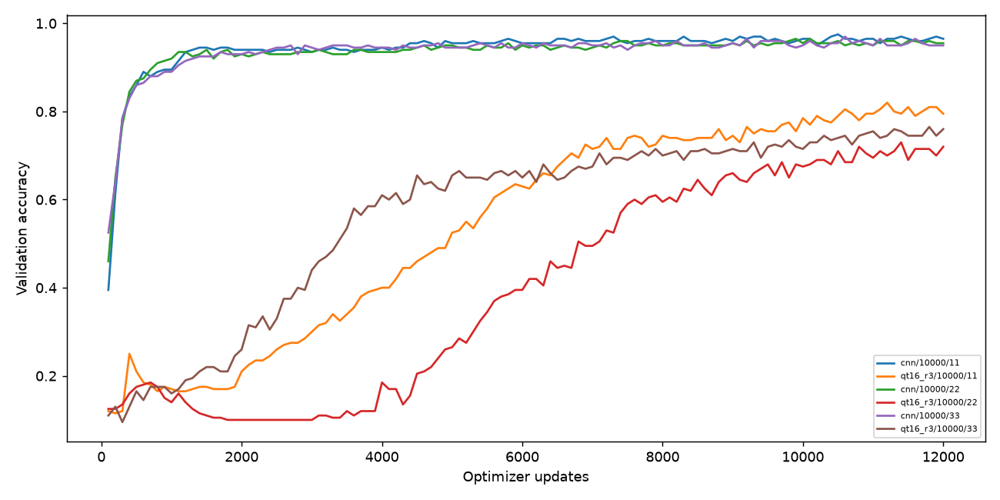

# MNIST固定10000筆更新延長研究

Study: `paper-data-extended-d206b2e56a`

|                    |   n |   train_mean |   val_mean |    val_std |   val_loss_mean |
|:-------------------|----:|-------------:|-----------:|-----------:|----------------:|
| ('cnn', 10000)     |   3 |     0.986567 |   0.963333 | 0.00288675 |        0.086825 |
| ('qt16_r3', 10000) |   3 |     0.7495   |   0.76     | 0.0377492  |        0.781071 |

| condition   |   train_size |   seed |   parameters |   updates |   examples_seen |   unique_examples_seen |   best_update |   train_accuracy |   val_accuracy |   val_loss |   final_val_accuracy | export_delta   |
|:------------|-------------:|-------:|-------------:|----------:|----------------:|-----------------------:|--------------:|-----------------:|---------------:|-----------:|---------------------:|:---------------|
| cnn         |        10000 |     11 |         6690 |     12000 |         1536000 |                  10000 |         10900 |           0.9896 |          0.965 |  0.088917  |                0.965 | N/A            |
| qt16_r3     |        10000 |     11 |          457 |     12000 |         1536000 |                  10000 |         12000 |           0.7671 |          0.795 |  0.704439  |                0.795 | 0.0            |
| cnn         |        10000 |     22 |         6690 |     12000 |         1536000 |                  10000 |         10100 |           0.9884 |          0.965 |  0.0883809 |                0.955 | N/A            |
| qt16_r3     |        10000 |     22 |          457 |     12000 |         1536000 |                  10000 |         12000 |           0.7335 |          0.72  |  0.842596  |                0.72  | 0.0            |
| cnn         |        10000 |     33 |         6690 |     12000 |         1536000 |                  10000 |          9700 |           0.9817 |          0.96  |  0.0831772 |                0.95  | N/A            |
| qt16_r3     |        10000 |     33 |          457 |     12000 |         1536000 |                  10000 |         11800 |           0.7479 |          0.765 |  0.796177  |                0.76  | 0.0            |

每線一個模型/資料量/seed；橫軸updates。兩組同updates、每batch128、相同validation及評估次數。使用有放回抽樣，不能直接與舊epoch shuffle研究混比。集合交集與nested狀態見manifest；best/final分開，validation曾參與開發，非盲測。未使用official test，不是完整論文MNIST重現。

## 固定更新節點
| condition   |   seed |   update |   val_accuracy |   val_loss |
|:------------|-------:|---------:|---------------:|-----------:|
| cnn         |     11 |     4000 |          0.945 |  0.129658  |
| cnn         |     11 |     8000 |          0.96  |  0.093161  |
| cnn         |     11 |    12000 |          0.965 |  0.100306  |
| qt16_r3     |     11 |     4000 |          0.4   |  1.72239   |
| qt16_r3     |     11 |     8000 |          0.745 |  0.868429  |
| qt16_r3     |     11 |    12000 |          0.795 |  0.704439  |
| cnn         |     22 |     4000 |          0.935 |  0.174897  |
| cnn         |     22 |     8000 |          0.95  |  0.106102  |
| cnn         |     22 |    12000 |          0.955 |  0.101446  |
| qt16_r3     |     22 |     4000 |          0.185 |  2.29507   |
| qt16_r3     |     22 |     8000 |          0.595 |  1.22508   |
| qt16_r3     |     22 |    12000 |          0.72  |  0.842596  |
| cnn         |     33 |     4000 |          0.945 |  0.146757  |
| cnn         |     33 |     8000 |          0.95  |  0.102222  |
| cnn         |     33 |    12000 |          0.95  |  0.0983085 |
| qt16_r3     |     33 |     4000 |          0.61  |  1.2887    |
| qt16_r3     |     33 |     8000 |          0.7   |  0.958027  |
| qt16_r3     |     33 |    12000 |          0.76  |  0.798911  |

本輪只固定10000筆延長updates，非新的1000/10000比較。Best有更多選模機會，應優先對照固定節點；尚非論文完整資料重現。

## Recovery provenance
原study：`C:\Users\sam01\Personal\20-Projects\QuantumTrain-Evaluation\results\paper-data-extended-aa21c465c5`。完成組沿用；初始化重跑：['qt16_r3-n10000-seed33']；完整checkpoint續訓：[]。詳見manifest.json的recovery欄位；舊checkpoint無optimizer時不稱精確續訓。
