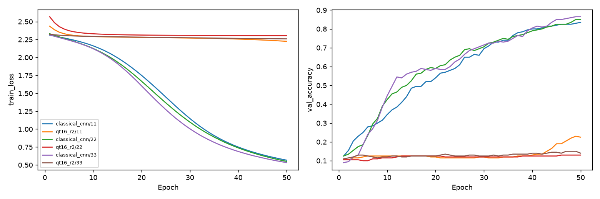

# MNIST r2較長學習pilot

Study: `paper-r2-learning-331edce2ee`

| condition     |   n |   parameters |     ratio |   train_mean |   val_mean |   val_std |   val_loss_mean |   final_val_mean |   train_seconds |
|:--------------|----:|-------------:|----------:|-------------:|-----------:|----------:|----------------:|-----------------:|----------------:|
| classical_cnn |   3 |         6690 | 1         |     0.854667 |      0.85  | 0.015     |        0.638166 |            0.85  |         30.8809 |
| qt16_r2       |   3 |          457 | 0.0683109 |     0.160333 |      0.165 | 0.0522015 |        2.27663  |            0.165 |        279.023  |

| condition     |   seed |   parameters |   parameter_ratio |   best_epoch |   best_train_accuracy |   best_val_accuracy |   best_val_loss |   final_train_accuracy |   final_val_accuracy |   train_seconds | export_delta   |
|:--------------|-------:|-------------:|------------------:|-------------:|----------------------:|--------------------:|----------------:|-----------------------:|---------------------:|----------------:|:---------------|
| classical_cnn |     11 |         6690 |         1         |           50 |                 0.846 |               0.835 |        0.663115 |                  0.846 |                0.835 |         38.2969 | N/A            |
| qt16_r2       |     11 |          457 |         0.0683109 |           50 |                 0.207 |               0.225 |        2.24423  |                  0.207 |                0.225 |        370.178  | 0.0            |
| classical_cnn |     22 |         6690 |         1         |           50 |                 0.862 |               0.85  |        0.622415 |                  0.862 |                0.85  |         40.4221 | N/A            |
| qt16_r2       |     22 |          457 |         0.0683109 |           50 |                 0.131 |               0.13  |        2.30601  |                  0.131 |                0.13  |        274.816  | 0.0            |
| classical_cnn |     33 |         6690 |         1         |           50 |                 0.856 |               0.865 |        0.628967 |                  0.856 |                0.865 |         13.9236 | N/A            |
| qt16_r2       |     33 |          457 |         0.0683109 |           50 |                 0.143 |               0.14  |        2.27966  |                  0.143 |                0.14  |        192.075  | 0.0            |

每線一個condition/seed，1000train/200validation。Best train/validation同checkpoint；final另存。論文MNIST60000train、10000test，本pilot不讀official test，不能將本validation accuracy稱重現論文test。參數比例6.831%是架構計數，不證明accuracy維持。updates.json記錄最後batch梯度norm與epoch首尾delta，不是每batch平均。計時僅本機train-only，不代表QPU加速。
