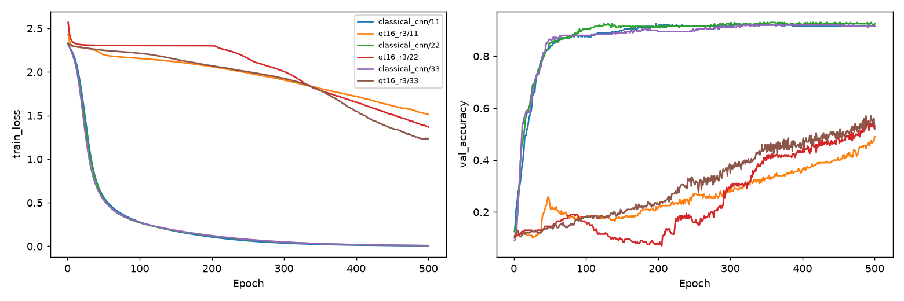

# MNIST r3更新預算研究

Study: `paper-r3-budget-e20332a432`

| condition     |   n |   parameters |     ratio |   train_mean |   val_mean |   val_std |   val_loss_mean |   final_val_mean |   train_seconds |
|:--------------|----:|-------------:|----------:|-------------:|-----------:|----------:|----------------:|-----------------:|----------------:|
| classical_cnn |   3 |         6690 | 1         |     0.976333 |       0.91 | 0.0132288 |         0.31404 |         0.918333 |         104.411 |
| qt16_r3       |   3 |          457 | 0.0683109 |     0.55     |       0.53 | 0.04      |         1.42832 |         0.513333 |         802.182 |

| condition     |   seed |   parameters |   parameter_ratio |   best_epoch |   best_train_accuracy |   best_val_accuracy |   best_val_loss |   final_train_accuracy |   final_val_accuracy |   train_seconds | export_delta   |
|:--------------|-------:|-------------:|------------------:|-------------:|----------------------:|--------------------:|----------------:|-----------------------:|---------------------:|----------------:|:---------------|
| classical_cnn |     11 |         6690 |         1         |          229 |                 0.982 |               0.915 |        0.311931 |                  1     |                0.915 |        106.079  | N/A            |
| qt16_r3       |     11 |          457 |         0.0683109 |          500 |                 0.487 |               0.49  |        1.58201  |                  0.487 |                0.49  |        828.77   | 0.0            |
| classical_cnn |     22 |         6690 |         1         |          214 |                 0.973 |               0.92  |        0.298431 |                  1     |                0.925 |         89.9224 | N/A            |
| qt16_r3       |     22 |          457 |         0.0683109 |          500 |                 0.567 |               0.53  |        1.41779  |                  0.567 |                0.53  |        732.404  | 0.0            |
| classical_cnn |     33 |         6690 |         1         |          219 |                 0.974 |               0.895 |        0.331759 |                  1     |                0.915 |        117.233  | N/A            |
| qt16_r3       |     33 |          457 |         0.0683109 |          495 |                 0.596 |               0.57  |        1.28515  |                  0.59  |                0.52  |        845.37   | 0.0            |

每線一個condition/seed，1000train/200validation。Best train/validation同checkpoint；final另存。論文MNIST60000train、10000test，本pilot不讀official test，不能將本validation accuracy稱重現論文test。參數比例6.831%是架構計數，不證明accuracy維持。updates.json記錄最後batch梯度norm與epoch首尾delta，不是每batch平均。計時僅本機train-only，不代表QPU加速。

## 固定預算節點
| condition     |   seed |   epoch |   updates |   train_accuracy |   val_accuracy |   val_loss |
|:--------------|-------:|--------:|----------:|-----------------:|---------------:|-----------:|
| classical_cnn |     11 |      50 |       400 |            0.846 |          0.835 |   0.663115 |
| classical_cnn |     11 |     100 |       800 |            0.924 |          0.88  |   0.414824 |
| classical_cnn |     11 |     200 |      1600 |            0.974 |          0.915 |   0.317764 |
| classical_cnn |     11 |     500 |      4000 |            1     |          0.915 |   0.432608 |
| qt16_r3       |     11 |      50 |       400 |            0.219 |          0.23  |   2.22651  |
| qt16_r3       |     11 |     100 |       800 |            0.206 |          0.18  |   2.2036   |
| qt16_r3       |     11 |     200 |      1600 |            0.254 |          0.22  |   2.14345  |
| qt16_r3       |     11 |     500 |      4000 |            0.487 |          0.49  |   1.58201  |
| classical_cnn |     22 |      50 |       400 |            0.862 |          0.85  |   0.622415 |
| classical_cnn |     22 |     100 |       800 |            0.921 |          0.905 |   0.383755 |
| classical_cnn |     22 |     200 |      1600 |            0.966 |          0.91  |   0.301437 |
| classical_cnn |     22 |     500 |      4000 |            1     |          0.925 |   0.442784 |
| qt16_r3       |     22 |      50 |       400 |            0.148 |          0.145 |   2.30604  |
| qt16_r3       |     22 |     100 |       800 |            0.148 |          0.16  |   2.30369  |
| qt16_r3       |     22 |     200 |      1600 |            0.083 |          0.075 |   2.30089  |
| qt16_r3       |     22 |     500 |      4000 |            0.567 |          0.53  |   1.41779  |
| classical_cnn |     33 |      50 |       400 |            0.856 |          0.865 |   0.628967 |
| classical_cnn |     33 |     100 |       800 |            0.918 |          0.88  |   0.415922 |
| classical_cnn |     33 |     200 |      1600 |            0.97  |          0.895 |   0.335175 |
| classical_cnn |     33 |     500 |      4000 |            1     |          0.915 |   0.491525 |
| qt16_r3       |     33 |      50 |       400 |            0.156 |          0.14  |   2.27328  |
| qt16_r3       |     33 |     100 |       800 |            0.17  |          0.18  |   2.25201  |
| qt16_r3       |     33 |     200 |      1600 |            0.225 |          0.23  |   2.09511  |
| qt16_r3       |     33 |     500 |      4000 |            0.59  |          0.52  |   1.2942   |

節點是當下epoch模型，不是事後挑選。500epochs=4000updates，只重複1000筆，不等於60000筆完整MNIST。
