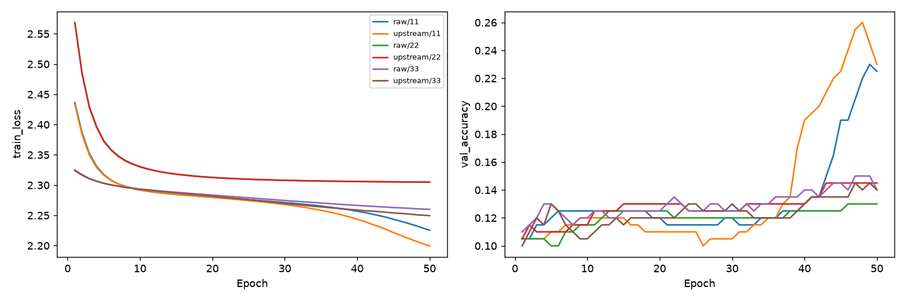

# MNIST r2/r3機率後處理pilot

Study: `paper-r3-ad19c7a0dc`

| condition   |   n |   train_mean |   val_mean |   val_std |   val_loss_mean |
|:------------|----:|-------------:|-----------:|----------:|----------------:|
| raw         |   3 |     0.160333 |   0.165    | 0.0522015 |         2.27663 |
| upstream    |   3 |     0.174333 |   0.171667 | 0.05058   |         2.26861 |

| condition   |   seed |   parameters |   best_epoch |   train_accuracy |   val_accuracy |   val_loss |   final_val_accuracy |   export_delta |
|:------------|-------:|-------------:|-------------:|-----------------:|---------------:|-----------:|---------------------:|---------------:|
| raw         |     11 |          457 |           50 |            0.207 |          0.225 |    2.24423 |                0.225 |              0 |
| upstream    |     11 |          457 |           50 |            0.219 |          0.23  |    2.22651 |                0.23  |              0 |
| raw         |     22 |          457 |           50 |            0.131 |          0.13  |    2.30601 |                0.13  |              0 |
| upstream    |     22 |          457 |           50 |            0.148 |          0.145 |    2.30604 |                0.145 |              0 |
| raw         |     33 |          457 |           50 |            0.143 |          0.14  |    2.27966 |                0.14  |              0 |
| upstream    |     33 |          457 |           50 |            0.156 |          0.14  |    2.27328 |                0.14  |              0 |

兩組均457參數、global center；只改mapping的機率欄。Train/validation同best-validation-loss checkpoint，final另列。1000/200、50epochs不是論文完整資料；未使用official test。不把參數比當accuracy維持證據。公式對p做一次tanh/冪次，不再平方p。配置、來源假設、初始尺度/梯度與更新見manifest.json及docs/paper-r3-protocol.md。
