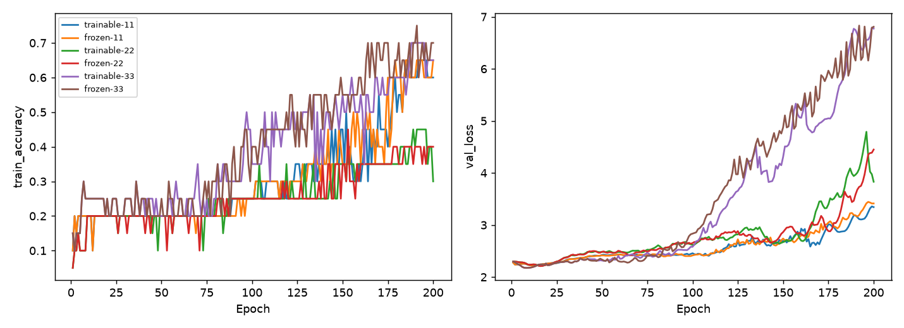

# 量子敏感度與固定參數消融

Study: `quantum-ablation-11d5b7a1fc`

| condition   |   seed |   max_train_accuracy |   final_train_accuracy |   best_val_accuracy |   best_val_loss |   best_epoch |   zero_feature_weight_relative_delta |
|:------------|-------:|---------------------:|-----------------------:|--------------------:|----------------:|-------------:|-------------------------------------:|
| trainable   |     11 |                 0.65 |                   0.6  |            0.144847 |         2.22214 |           12 |                          9.86814e-05 |
| frozen      |     11 |                 0.65 |                   0.65 |            0.144847 |         2.22214 |           12 |                          1.01502e-05 |
| trainable   |     22 |                 0.45 |                   0.3  |            0.158774 |         2.21118 |           16 |                          4.30803e-05 |
| frozen      |     22 |                 0.45 |                   0.4  |            0.158774 |         2.21119 |           16 |                          8.40119e-06 |
| trainable   |     33 |                 0.7  |                   0.65 |            0.172702 |         2.17518 |            8 |                          0.000190995 |
| frozen      |     33 |                 0.75 |                   0.7  |            0.172702 |         2.17517 |            8 |                          2.05123e-05 |

相同20筆資料、同seed原始模型參數，只有量子參數是否更新不同。Frozen仍使用初始量子機率，不是無量子模型。Null量子梯度是預期固定，不是錯誤。敏感度使用一個固定方向，不能代表所有方向；feature置零是未重訓干預，不是零特徵訓練baseline。Best依validation loss選擇，未使用test。當前低表現設定的消融不能推論一般量子優勢或無效。完整設定、環境、逐epoch資料與敏感度見manifest.json。
