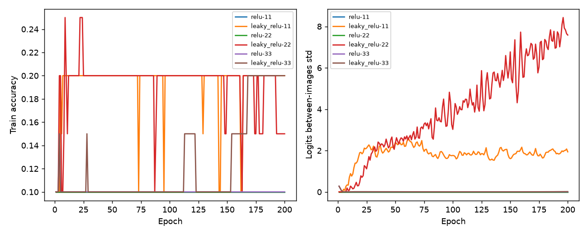

# 目標 activation 對照

Study: target-6d2e608121

| target     |   seed |   max_train_accuracy |   final_train_accuracy |   best_val_accuracy |   hidden_zero_fraction |   logits_std |
|:-----------|-------:|---------------------:|-----------------------:|--------------------:|-----------------------:|-------------:|
| relu       |     11 |                 0.1  |                   0.1  |            0.100279 |                      1 |    0         |
| leaky_relu |     11 |                 0.2  |                   0.2  |            0.153203 |                      0 |    1.93738   |
| relu       |     22 |                 0.1  |                   0.1  |            0.100279 |                      1 |    0         |
| leaky_relu |     22 |                 0.25 |                   0.15 |            0.189415 |                      0 |    7.58499   |
| relu       |     33 |                 0.15 |                   0.1  |            0.111421 |                      1 |    0         |
| leaky_relu |     33 |                 0.2  |                   0.2  |            0.111421 |                      0 |    0.0143442 |



左：固定20筆的訓練準確率；右：相同20筆的logits跨圖片標準差。每條線一個seed，未使用test。max_train_accuracy僅為擬合能力診斷，best_val_accuracy由最低validation loss checkpoint決定。

協定：
```json
{
  "depth": 3,
  "mapping": "affine",
  "targets": [
    "relu",
    "leaky_relu"
  ],
  "negative_slope": 0.01,
  "seeds": [
    11,
    22,
    33
  ],
  "epochs": 200,
  "smoke": false,
  "train_samples": 20,
  "split_seed": 2026,
  "test_access": false
}
```
